<p align="center">
<br>
</p>

<h1 align="center">Sknerus</h1>

<p align="center">
<a href="https://github.com/pnowy/sknerus/actions/workflows/ci.yaml"></a>&nbsp;<a href="https://github.com/pnowy/sknerus/actions/workflows/publish.yaml"></a>&nbsp;<a href="https://github.com/pnowy/sknerus/releases/latest"></a>&nbsp;<a href="https://github.com/pnowy/sknerus/blob/main/LICENSE"></a>
</p>

<p align="center">
<a href="#why-sknerus">Why Sknerus?</a>&nbsp;&bull;&nbsp;<a href="#quick-showcase">Quick Showcase</a>&nbsp;&bull;&nbsp;<a href="#features">Features</a>&nbsp;&bull;&nbsp;<a href="#screenshots">Screenshots</a><br><a href="#installation">Installation</a>&nbsp;&bull;&nbsp;<a href="#configuration">Configuration</a>&nbsp;&bull;&nbsp;<a href="#demo-data">Demo Data</a>
</p>

<br>

<p align="center">
<b>Sknerus</b> is a self-hosted personal finance tracker focused on clarity and speed. Track income and expenses across custom categories, visualize spending trends over time, and get a clear picture of your cashflow — all from a clean, modern interface.
</p>

<p align="center">
<em>💰 <b>Sknerus</b> (pronounced <em>skneh-roos</em>) is Polish for <b>Scrooge</b> — a penny-pinching miser who knows exactly where every złoty goes. If you're obsessive enough about your finances to self-host a tracker, the name fits.</em>
</p>

<p align="center">
  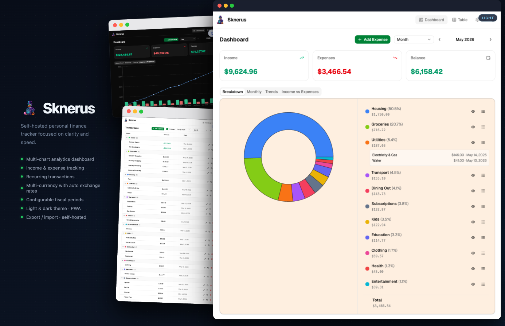
</p>

<br>

# Why Sknerus?

The original inspiration for this project was [ExpenseOwl](https://github.com/tanq16/expenseowl) — a simple self-hosted expense tracker. However, it is no longer actively developed and maintained, and it lacked a few things I needed: multi-chart dashboards, multi-currency support, and a richer data visualization experience.

Sknerus picks up where ExpenseOwl left off. It keeps the philosophy of **dead simple, self-hosted, single-user or family expense tracking**, while adding:

- A proper analytics dashboard with multiple chart types and time-range navigation
- Transactions view with grouping and sorting
- Full recurring expense management (create, edit, delete templates)
- Multi-currency support with automatic exchange rate resolution
- Optional plugins for vehicle costs and subscriptions
- One-click full backup and restore
- A modern SSR React stack (TanStack Start)

It is still *not* a budgeting app. No accounts, no complex budgets, no bank syncing. Just a fast, honest look at where your money goes.

# Quick Showcase

<p align="center">
  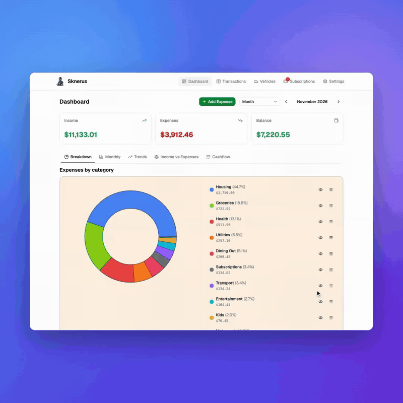
</p>

# Features

### Core Functionality

- Add income and expenses with category, date, amount, currency, optional tags, and free-text notes
- Toggle tags and notes on or off globally from Settings — disabled fields disappear from forms, tables, and cards if you don't use them
- Custom categories with color coding — reorder, rename, or remove them at any time; mark a category as income to preset the income toggle when adding a transaction
- Recurring transactions — define a template once, the app materializes entries automatically up to today
- Multi-currency support: record transactions in any currency, configure supported currencies, and exchange rates are resolved and cached automatically. Two providers available: [Frankfurter](https://www.frankfurter.app/) (31 currencies, no key needed) and [ExchangeRate-API](https://www.exchangerate-api.com/) (165 currencies, free API key required)
- Full backup and restore — all data (settings, transactions, recurring transactions, vehicles, subscriptions) in one JSON file
- CSV export and import — bring your transactions in from any tool or take them anywhere, also from ExpenseOwl
- Configurable fiscal month start date (e.g. set to 5 to count from the 5th of each month)
- Configurable default start page (dashboard or transactions)
- Floating add-expense button on mobile — placed in thumb reach, switchable between bottom right, bottom left, or off
- Light and dark theme with system-preference detection
- PWA — installable on desktop and mobile for a native-app feel

### Dashboard

The dashboard is the heart of the app, organized into five tabs (on phones they become a swipeable row of chips):

1. **Breakdown** — pie charts of spending by category and income by source for the selected period, plus cashflow cards showing total income, total expenses, and net balance. Use the eye icon next to a category to temporarily exclude it from the chart.
2. **Monthly** — stacked bar chart of expenses across all months, broken down by category, to spot seasonal patterns.
3. **Trends** — category-level trend lines across months to see which spending areas are growing or shrinking.
4. **Income vs Expenses** — bar chart comparing income and spending month by month, giving a quick cashflow health view over time.
5. **Cashflow** — Sankey diagram of how income flows into expense categories, with each node's amount and share. Smaller categories are grouped into an expandable "Other" node.

All dashboard views support flexible time-range navigation: switch between monthly, quarterly, and yearly scopes and step forward/backward through time. Choose **Custom** to filter by an exact start and end date (both inclusive). Custom ranges are saved in the URL and preserved when switching dashboard tabs; click the displayed dates to edit them.

### Transactions

- Chronological list of all transactions for the selected period
- The same preset and custom date ranges as the dashboard
- Optional search (enable **Show search** in Settings → Appearance → Display): click the search icon to find transactions by name, notes, or tags across your whole history; Esc clears the query, then closes search
- Toggle between flat list and grouped-by-category view
- Inline delete with confirmation
- Add new expenses directly from the transactions view

### Settings

Settings are split into tabs — **General**, **Transactions**, **Appearance**, **Data**, plus one tab per enabled plugin (see [In-App Settings](#in-app-settings) for details):

- Add, rename, reorder, and delete categories (drag-and-drop ordering)
- Set primary currency and a list of supported currencies for multi-currency entry
- Configure fiscal month start date and default start page
- Choose the side of the mobile floating add-expense button (or turn it off)
- Toggle visibility of tags and notes fields across the app, and enable transaction search in the transactions view
- Manage recurring transactions (view, edit, delete templates) — repeat every N days, weeks, months, or years (e.g. every 3 months)
- Download a full backup (settings, transactions, recurring transactions, vehicles, subscriptions) and restore it on any instance; export and import transactions as CSV
- Enable optional plugins (see below)

### Plugins

Optional features that extend the core tracker. Toggle them on under **Settings → General → Plugins** — they stay invisible until you need them, so the app stays focused for users who only want basic expense tracking.

#### Vehicle expense tracking

Track per-vehicle costs alongside your regular expenses. Once enabled, a **Vehicles** page appears in the navigation and a **Vehicles** tab appears in Settings (category → vehicle mapping). You can:

- Register one or more vehicles (car or motorcycle) with engine size, fuel tank size, fuel type, and starting odometer
- Bind a category to a vehicle so any expense in that category is automatically a vehicle expense
- Pick an expense type per transaction — Fuel, Insurance, Oil change, Purchase, or Accessories — and customize the name, icon, and color of each type per vehicle (the icon/color shows up next to the expense name in tables and cards)
- Record fuel fills with liters, odometer reading, and post-fill tank level to compute real-world L/100km consumption
- Set oil-change intervals in both kilometers and months — the app warns when either threshold is approaching, whichever comes first
- Track insurance and technical inspection expiry dates with status indicators (ok / warning / critical)
- Open the **Stats** dialog on a vehicle for a fuel history table and a weekly spend-breakdown chart across all expense types

> Units are metric: kilometers, liters, L/100km. Imperial units (miles, gallons, MPG) are not currently supported — open an issue if you'd like a metric/imperial toggle.

#### Subscription tracking

See what your subscriptions really cost per month and per year. Once enabled, a **Subscriptions** page appears in the navigation and a **Subscriptions** tab appears in Settings:

- Add subscriptions with a price per billing period (monthly, every 3/6 months, yearly, or any number of months) in any supported currency — costs are converted to your primary currency at today's exchange rate and spread per month
- Summary cards for monthly and yearly totals, the cost after deductions, and your monthly tax savings, plus a cost-share bar and Private / Business / Inactive filters
- Mark a subscription as a business cost by assigning a **deduction profile** (Settings → Subscriptions). A profile defines the VAT rate, the share of VAT you recover, your income tax rate, and an optional extra rate (e.g. a health contribution) — so it fits any tax setup, not just one country's. Non-recovered VAT is added to the cost before income tax is deducted. Turn off "Price includes VAT" for invoices without VAT (e.g. reverse-charge services from abroad)
- The info icon on each subscription shows the per-month breakdown: price → VAT back → tax back → real cost
- The **Stats** dialog on a subscription summarizes its payments (linked manually or booked by a recurring transaction): total paid, last payment, price change since the first payment, cost after deductions, plus a payment history with the change vs the previous payment, a per-year bar chart, and a price trend chart

**Manual payments** — for subscriptions you renew by hand (e.g. a yearly plan you may or may not extend):

- Link past transactions to the subscription with **Link payments** (search pre-filled with the subscription name); the next renewal is set one billing period after the latest payment
- A week before the renewal date the subscription shows up under **Due for renewal** on the Subscriptions page, with a badge on the navigation link. Nothing is booked automatically: **Book payment** creates the transaction (amount and date editable, optionally updating the subscription price) and moves the renewal one period ahead, **Skip** moves it ahead without a transaction, **End** deactivates the subscription
- Overdue renewals stay visible until you act on them
- Subscriptions billed less often than monthly (quarterly, yearly, …) get a subtle blue "Renews in N days" note in the list from 30 days before renewal, so there's time to cancel or switch plans

**Linking with recurring transactions** — a subscription can book its payments as a recurring expense:

- **Create** a recurring transaction from the subscription form (pick the first payment date), **link** an existing one, or use **Track as subscription** on a recurring transaction in Settings. **Import from recurring** on the Subscriptions page converts several monthly/yearly recurring expenses at once
- Name, price, currency, billing period, and category stay in sync both ways. Deactivating a subscription ends its recurring transaction; reactivating it or changing the billing period restarts the schedule from today, so missed periods are never backfilled
- Linked subscriptions show their next payment date and the total paid so far; linked recurring transactions get a **Subscription** badge that jumps to the subscription
- Deleting a recurring transaction keeps the subscription (unlinked). Deleting a subscription can optionally delete its recurring transaction too. Transactions that were already booked are never changed
- Daily and weekly recurring transactions, and income, can't be linked

# Screenshots

<details>
<summary>Click to expand screenshots</summary>

| Page                                            | View                                                |
|-------------------------------------------------|-----------------------------------------------------|
| Desktop - Dashboard – Breakdown (light)         | 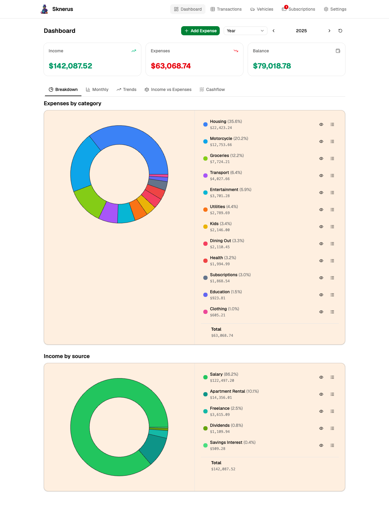          |
| Desktop - Dashboard – Income vs Expenses (dark) | 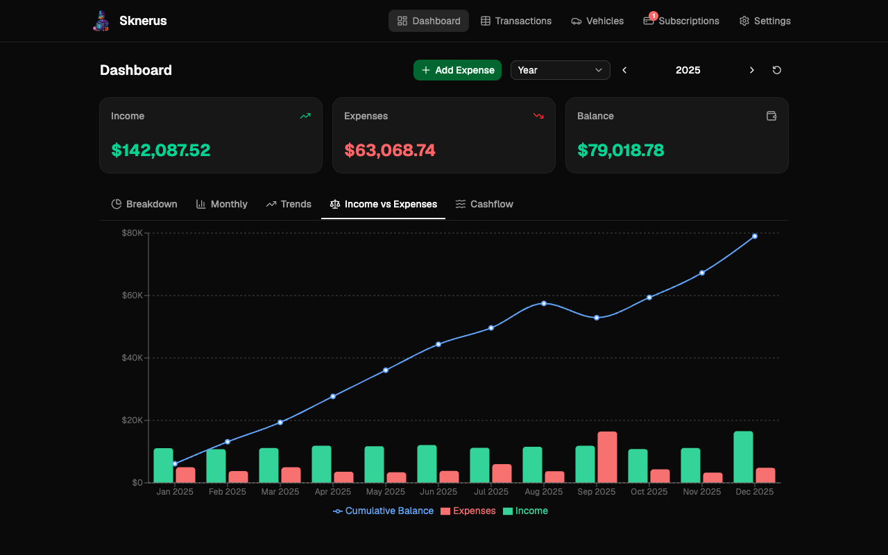 |
| Desktop - Dashboard – Monthly (light)           | 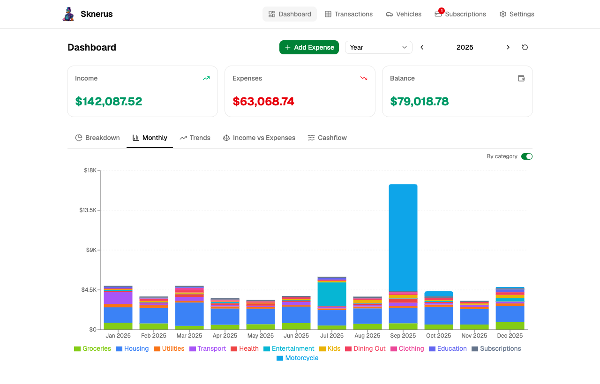            |
| Desktop - Dashboard – Trends (dark)             | 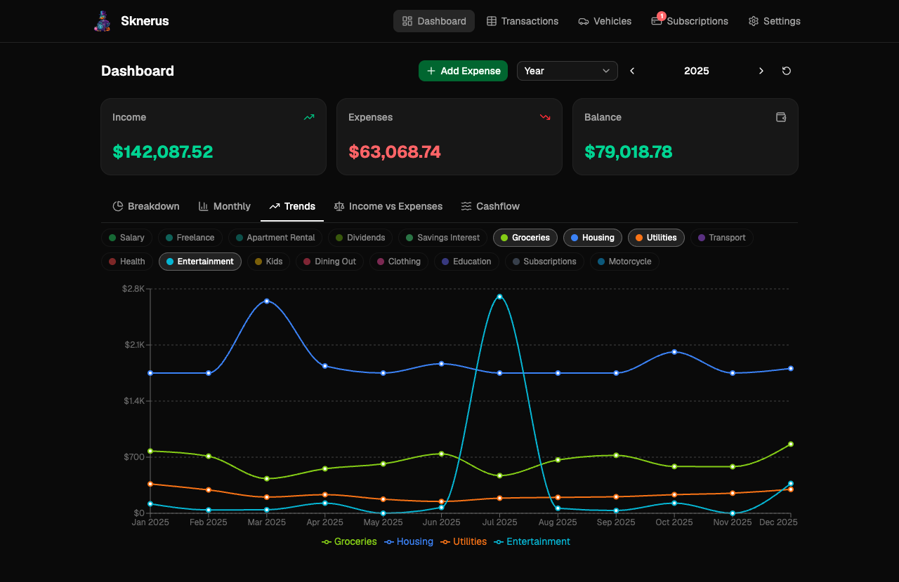             |
| Desktop - Dashboard – Cashflow (light)          | 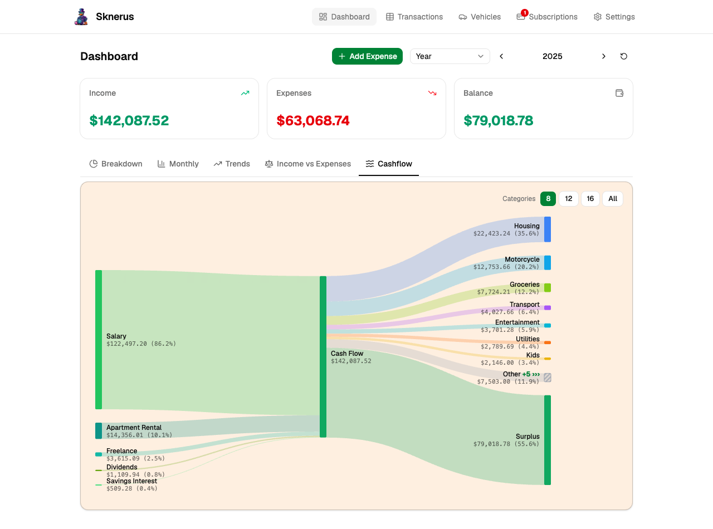           |
| Mobile - Transactions                           | 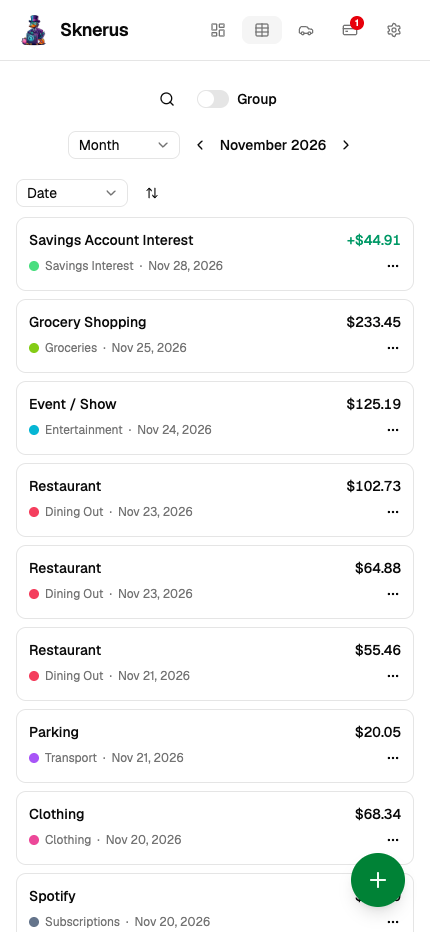                         |
| Desktop - Transactions                          | 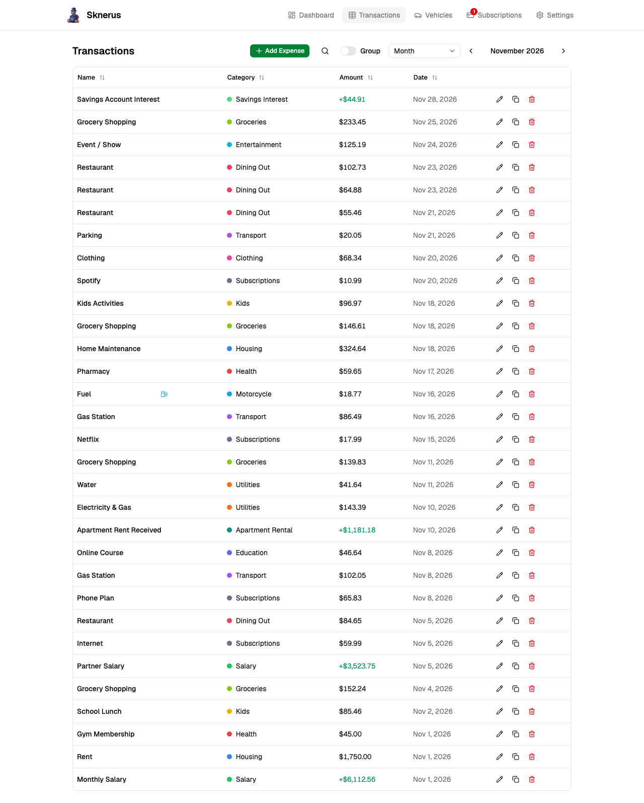                   |
| Desktop - Transactions (group by category)      | 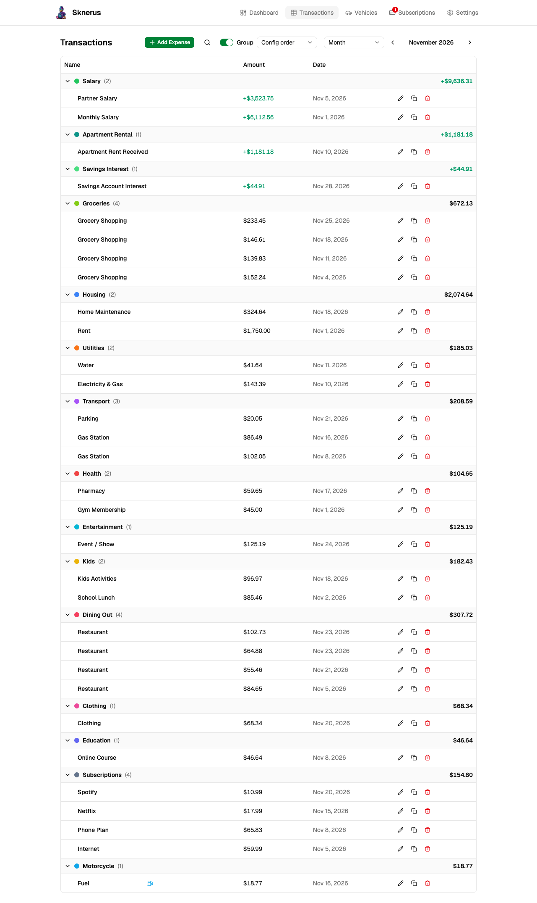                |
| Desktop - Settings                              | 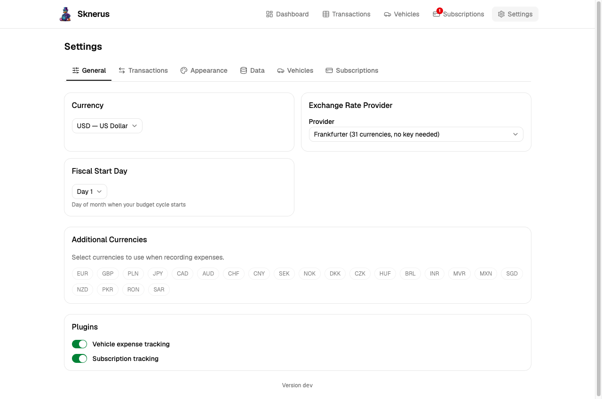                     |
| Desktop - Settings – Full backup                | 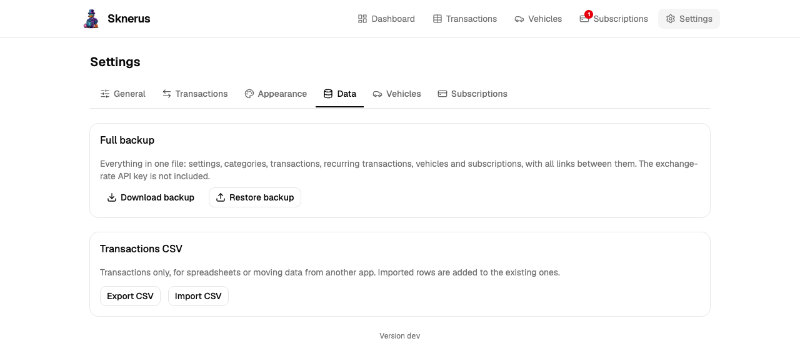              |
| Desktop - Vehicles                              | 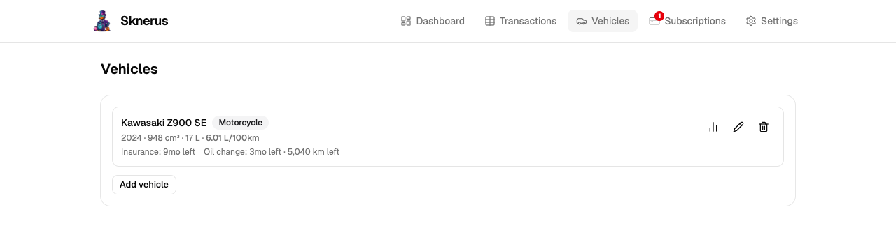                     |
| Desktop - Vehicle Stats                         | 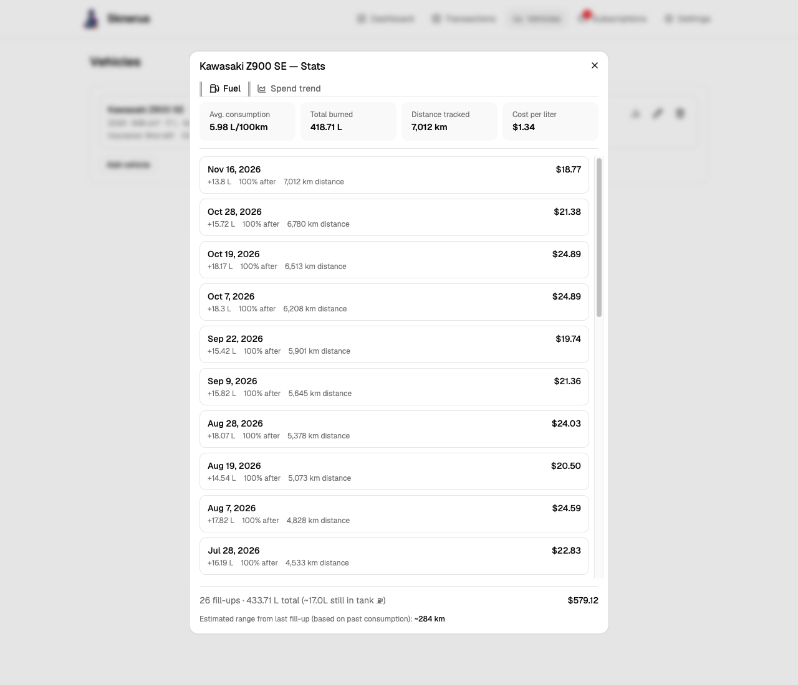                        |
| Desktop - Subscriptions                         | 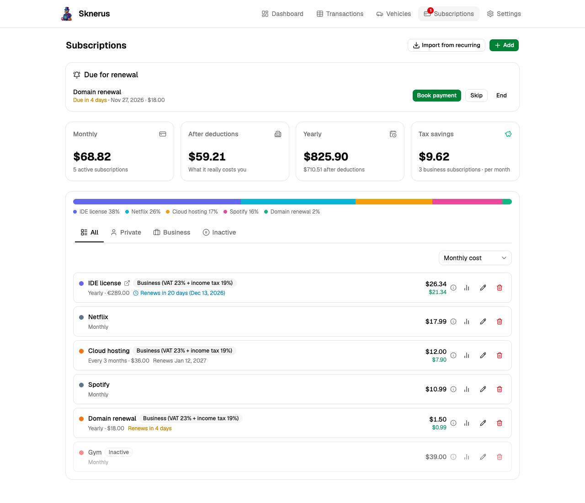                |
| Desktop - Subscription (manual payments)        | 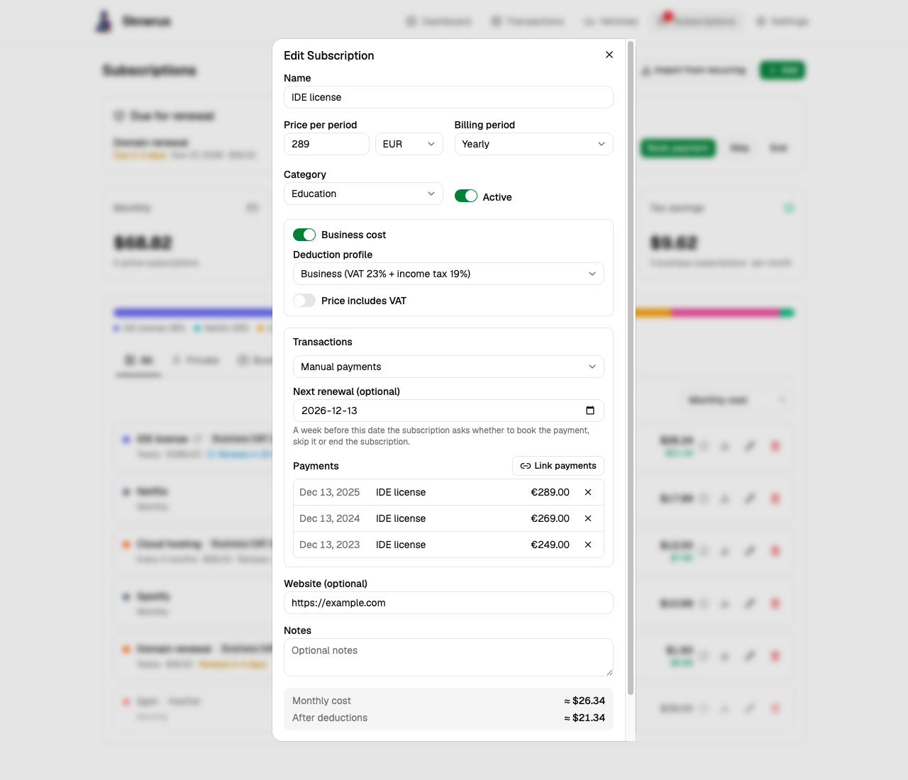                    |
| Desktop - Subscription Stats                    | 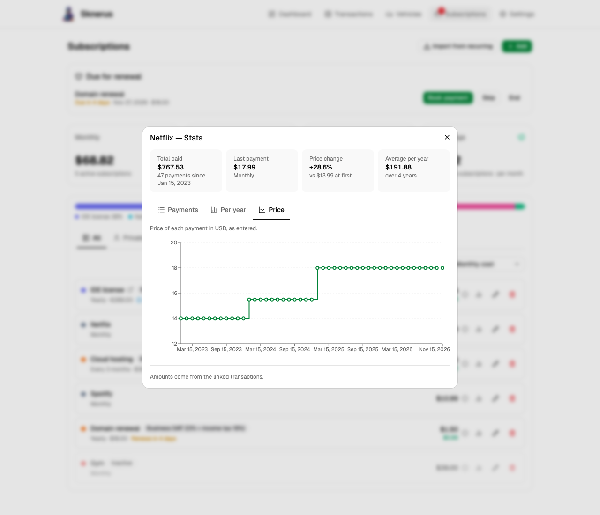                   |

</details>

# Installation

The recommended way to run Sknerus is with Docker.

Use `ghcr.io/pnowy/sknerus:stable` to follow tagged releases. The `latest` tag follows builds from `main`; version tags are also available to pin a specific release.

### Docker CLI

```bash
docker run -d \
  --name sknerus \
  -p 3000:3000 \
  -v sknerus-data:/app/.data \
  ghcr.io/pnowy/sknerus:latest
```

### Docker Compose

```yaml
services:
  sknerus:
    image: ghcr.io/pnowy/sknerus:latest
    restart: unless-stopped
    ports:
      - "3000:3000"
    volumes:
      - ./data:/app/.data
    environment:
      # Optional — seed demo data on first run (no existing data required)
      # SEED_DEMO_DATA: "true"
```

The app will be available at `http://localhost:3000`.

### Building from Source

```bash
git clone https://github.com/pnowy/sknerus.git
cd sknerus
pnpm install
pnpm build
node .output/server/index.mjs
```

For development:

```bash
pnpm dev   # starts dev server at http://localhost:3000
```

# Configuration

All configuration is done either via environment variables (infrastructure-level) or through the in-app Settings page (user-level).

### Environment Variables

| Variable                | Default   | Description                                                                                             |
|-------------------------|-----------|---------------------------------------------------------------------------------------------------------|
| `PORT`                  | `3000`    | Port the server listens on                                                                              |
| `DATA_DIR`              | `.data`   | Directory where JSON data files are stored                                                              |
| `SEED_DEMO_DATA`        | _(unset)_ | Set to `true` to seed demo data on first run (see below)                                                |
| `LOG_LEVEL`             | `info`    | Log verbosity: `debug`, `info`, `warn`, `error`                                                         |
| `EXCHANGE_RATE_API_KEY` | _(unset)_ | API key for [ExchangeRate-API](https://www.exchangerate-api.com/) (alternative to setting it in the UI) |

### REST API

The versioned REST API is also used by the web UI and is always available:

```bash
curl http://localhost:3000/api/v1/expenses
```

All endpoints are under `/api/v1` and return JSON. Expense amounts are signed (negative for expenses, positive for income); `date` uses `YYYY-MM-DD`.

| Method          | Endpoint                                         | Description                                                                                            |
|-----------------|--------------------------------------------------|--------------------------------------------------------------------------------------------------------|
| `GET`           | `/expenses`                                      | List expenses; optional `from`, `to`, `categoryId`, and `tag` query filters                            |
| `POST`          | `/expenses`                                      | Create an expense; `currency` defaults to the configured currency and `tags` defaults to an empty list |
| `GET`           | `/expenses/:id`                                  | Get one expense                                                                                        |
| `PUT`           | `/expenses/:id`                                  | Replace an expense                                                                                     |
| `PATCH`         | `/expenses/:id`                                  | Update supplied expense fields                                                                         |
| `DELETE`        | `/expenses/:id`                                  | Delete an expense                                                                                      |
| `GET`           | `/categories`                                    | List categories                                                                                        |
| `POST`          | `/categories/:id/rename`                         | Rename a category with `{ "newName": "..." }`                                                          |
| `GET`, `PUT`    | `/config`                                        | Get or replace app configuration                                                                       |
| `GET`, `POST`   | `/recurring`                                     | List or create recurring transactions                                                                  |
| `PUT`, `DELETE` | `/recurring/:id`                                 | Update or delete a recurring transaction                                                               |
| `POST`          | `/recurring/materialize`                         | Create due recurring expenses                                                                          |
| `GET`, `POST`   | `/vehicles`                                      | List or create vehicles                                                                                |
| `PUT`, `DELETE` | `/vehicles/:id`                                  | Update or delete a vehicle                                                                             |
| `GET`, `POST`   | `/subscriptions`                                 | List or create subscriptions                                                                           |
| `PUT`, `DELETE` | `/subscriptions/:id`                             | Update or delete a subscription                                                                        |
| `POST`          | `/subscriptions/:id/book`                        | Book a manual renewal payment (creates the transaction, moves the next renewal)                        |
| `POST`          | `/subscriptions/:id/skip`                        | Skip a manual renewal without booking a transaction                                                    |
| `POST`          | `/subscriptions/import-recurring`                | Convert recurring transactions into subscriptions                                                      |
| `GET`           | `/backup`                                        | Download a full backup (JSON, without the exchange-rate API key)                                       |
| `POST`          | `/backup`                                        | Restore a full backup — replaces all data                                                              |
| `GET`           | `/exchange-rate?date=YYYY-MM-DD&from=USD&to=PLN` | Resolve an exchange rate                                                                               |

The API uses the same JSON storage as the web app.

### In-App Settings

Everything else is configured from the `/settings` page, grouped into tabs (the active tab is kept in the URL, e.g. `/settings?section=transactions`):

**General**

- **Currency** — set the primary display currency
- **Exchange Rate Provider** — choose between Frankfurter (31 major currencies, no setup) or ExchangeRate-API (165 currencies including MVR, THB, etc. — requires a free API key)
- **Fiscal Start Day** — day of month that begins a new fiscal period (default: 1st)
- **Additional Currencies** — currencies available when adding a transaction (exchange rates resolved automatically)
- **Plugins** — enable optional features such as vehicle or subscription tracking. See the [Plugins](#plugins) section above for details.

**Transactions**

- **Categories** — add, rename, reorder (drag-and-drop), and delete categories
- **Recurring Transactions** — manage recurring income and expense templates

**Appearance**

- **Start Page** — which page loads first: dashboard or transactions
- **Theme** — light, dark, or follow the system
- **Display** — show or hide tags and notes, enable transaction search
- **Mobile Add Button** — position of the floating add-expense button on phones: bottom right (default), bottom left, or off

**Data**

- **Full backup** — download everything as one JSON file (settings, categories, transactions, recurring transactions, vehicles, subscriptions, and the links between them) or restore such a file. Restoring replaces all current data after a confirmation; a file with duplicate ids is rejected, and links to records missing from the file (e.g. a payment that was deleted) are dropped. The exchange-rate API key is never written to the file and the one configured on the instance is kept
- **Transactions CSV** — export transactions as CSV or import a CSV, adding its rows to the existing transactions. The import modal in the app describes the expected format and supported columns in detail.

Enabled plugins add their own tabs with plugin configuration: **Vehicles** (category → vehicle mapping) and **Subscriptions** (deduction profiles). The vehicles and subscriptions themselves live on their own pages in the navigation.

### Data Storage

Sknerus uses a simple file-based JSON storage by default. Data is stored in these files inside `DATA_DIR`:

- `expenses.json` — all transactions
- `config.json` — categories, currency, app settings, and deduction profiles
- `recurring.json` — recurring transaction templates
- `vehicles.json` — vehicles (vehicle plugin)
- `subscriptions.json` — subscriptions (subscription plugin)
- `exchange-rates.json` — cache for exchange rates data

Mount `DATA_DIR` as a persistent volume to retain data across container restarts.

> **Note:** Sknerus does not include authentication (neither for the web UI nor for the REST API). Use a reverse proxy (e.g. Nginx, Caddy, Traefik) with basic auth or SSO in front of it if exposing beyond localhost.

### Considered features

There is a bunch o potential features which could be added if there will interest. Some which I consider but don't need them in my use-case:

- extra storage types (SQL Database – PostgreSQL)
- authentication and authorization

# Demo Data

Sknerus ships with a built-in demo data generator that seeds ~2.5 years of realistic family budget data. It is useful for exploring the app before entering your own data.

**To enable:** set `SEED_DEMO_DATA=true` and start with no existing data (or a fresh `DATA_DIR`).

The seed generates:

- **17 categories**: Salary, Freelance, Apartment Rental, Dividends, Savings Interest, Groceries, Housing, Utilities, Transport, Health, Entertainment, Kids, Dining Out, Clothing, Education, Subscriptions, Motorcycle
- **Income**: primary salary (with annual raises), partner salary starting a few months in, December bonuses, occasional freelance income, monthly apartment rental, quarterly dividends, monthly savings interest
- **Fixed costs**: rent, internet, streaming subscriptions, gym membership
- **Variable costs**: groceries (3–4 trips/month), fuel, utilities with seasonal swings (higher in winter), dining out
- **Seasonal patterns**: clothing peaks in spring/autumn, summer vacation in July, Christmas spending in December, school supplies in August/September
- **Sporadic entries**: doctor visits, pharmacy, dental, car service, home maintenance
- **Vehicle plugin enabled** with a Kawasaki Z900 SE motorcycle bought ~14 months ago: purchase, two annual insurance cycles, gear/accessories, ~25 fuel fills with odometer readings (consumption around 6 L/100km), and two oil changes — enough to populate the fuel-history table and the weekly spend-trend chart
- **Subscription plugin enabled** with a business deduction profile and subscriptions covering every state: Netflix and Spotify with linked monthly payments and price increases over the years, a yearly IDE license paid in EUR renewing in ~3 weeks (shows the renewal note), a yearly domain due in a few days (shows **Due for renewal** and the navigation badge), quarterly cloud hosting, and an inactive gym membership

Once data exists, the seed is skipped automatically on subsequent starts — safe to leave the flag enabled.

# Show Your Support

If Sknerus saves you a few clicks (or a few złoty), consider:

- ⭐ **[Starring the repo](https://github.com/pnowy/sknerus/stargazers)** — it helps others discover the project
- 🚀 **[Reporting a bug or suggesting a feature](https://github.com/pnowy/sknerus/issues)** — feedback shapes the roadmap
- 🛠️ **Opening a PR** — contributions are welcome, big or small

No paid tier, no telemetry, no analytics — just an app I built for myself and shared. A star is the cheapest way to say thanks. 🙏